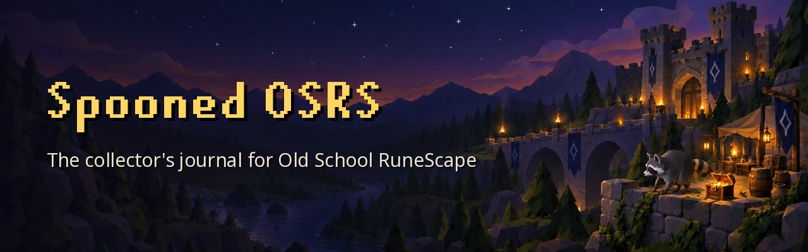
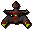
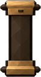

Track your pets and collection log, see how dry you really are, and compare with the&nbsp;community.

**[Website](https://spoonedosrs.com)** · **[Discord](https://discord.gg/spoonedosrs)** · **[Changelog](CHANGELOG.md)** · **[Report a bug](https://github.com/chris-fweather/spoonedosrs/issues/new)**

## Features

<table>
<tr>
<td align="center" width="50%" valign="top"> <b>Collection log</b> Every pet and log slot with the date you got it, on a zoomable&nbsp;timeline.</td>
<td align="center" width="50%" valign="top"> <b>Drop maths</b> Dry streaks, odds and hunt estimates, with the source of every drop&nbsp;rate.</td>
</tr>
<tr>
<td align="center" width="50%" valign="top"> <b>Leaderboards</b> Pets, collection log, combat achievements, quest points and total&nbsp;XP.</td>
<td align="center" width="50%" valign="top"> <b>Profiles</b> Your 3D character in its own scene, with titles, account badges and privacy&nbsp;controls.</td>
</tr>
<tr>
<td align="center" width="50%" valign="top"> <b>Guides</b> Boss and activity guides with gear setups for every&nbsp;budget.</td>
<td align="center" width="50%" valign="top"> <b>Discord</b> Sign in with Discord, and share profiles in our server with&nbsp;<code>/profile</code>.</td>
</tr>
</table>

Progress comes from the official Hiscores, [RuneProfile](https://runeprofile.com), [TempleOSRS](https://templeosrs.com) and [Wise Old Man](https://wiseoldman.net). Thanks to all&nbsp;of&nbsp;them.

## Why the code is public

Spooned OSRS is built in a private repository. Each release is published here, so anyone can see exactly what the site does with their account and&nbsp;their&nbsp;data.

To build it yourself, see [docs/development.md](docs/development.md).

## Suggestions and bugs

Got an idea or found something broken? Tell us on [Discord](https://discord.gg/spoonedosrs) or [open an&nbsp;issue](https://github.com/chris-fweather/spoonedosrs/issues).

Want to help write guides? Say hello on&nbsp;[Discord](https://discord.gg/spoonedosrs).

Please report security problems privately, as the [security&nbsp;policy](.github/SECURITY.md)&nbsp;explains.

## Built with

[React](https://react.dev) on [vinext](https://github.com/cloudflare/vinext), served by [Cloudflare Workers](https://workers.cloudflare.com) with a [D1](https://developers.cloudflare.com/d1/) database, and [Three.js](https://threejs.org) for the character&nbsp;scenes.

## Licence

The source code is released under the [MIT licence](LICENSE). Game artwork, OSRS Wiki data and fonts keep their own terms; see [third&#8209;party&nbsp;content](docs/third-party-content.md).

Spooned OSRS is a fan project. It is not affiliated with or endorsed by Jagex Ltd. Old School RuneScape is a trademark of Jagex&nbsp;Ltd.
