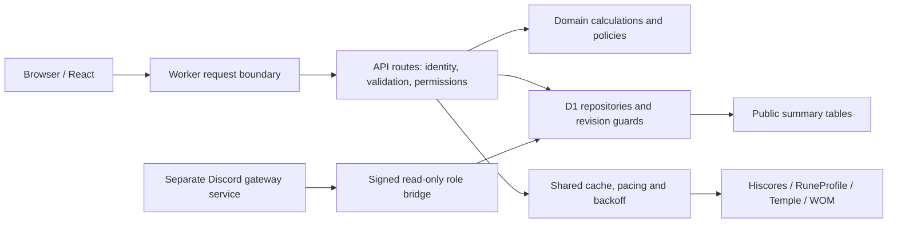

# Architecture

Spooned OSRS is a modular web application running on Cloudflare Workers. React
and vinext provide the user interface and server routes. D1 is the system of
record for site accounts, journals, permissions, moderation and release-era
schema changes. Upstream services supply game snapshots; they do not control
site ownership or staff authority.

## Request flow

## Responsibilities

| Area | Boundary and examples |
| --- | --- |
| UI | `app/` contains pages, components and styles. Browser code must not import database bindings or secrets. |
| HTTP boundary | `app/api/` validates request size and shape, authenticates identity and checks permissions before calling domain/storage code. |
| Domain rules | `lib/estimates.ts`, `lib/moderation-policy.ts`, `lib/presentation.ts` and related modules implement calculations and policy independently of page rendering. |
| Persistence | `lib/storage.ts`, staff stores and ordered `drizzle/` migrations own D1 reads/writes. Mutation SQL repeats critical identity/revision checks. |
| Public reads | Summary tables and privacy filtering bound leaderboard work and prevent private journal fields reaching anonymous clients. |
| Upstream reads | `lib/provider-client.ts` is the shared, read-only request boundary. It coordinates cache fills and provider pacing through D1. |
| Identity | Discord OAuth establishes site identity. Linked RuneScape names are site claims, not independent proof of game-account ownership. |
| Guides | Restricted document blocks and setup references are validated on the server. Publishing and editing are separate permissions. |
| Discord | The gateway bot is a separate process. It consumes a signed role endpoint and does not receive a D1 binding or website session secret. |

## Data and trust

Treat upstream responses, imported settings, guide text and browser payloads as
untrusted input. Persist only supported fields, bound payload sizes and preserve
unknown values. An unknown acquisition date must not become a sync date; a
missing individual combat-task state must not become a completed task.

Public profile data is filtered according to the linked account's visibility.
Discord staff roles apply to the Discord identity, across linked profiles.
Moderation cases separate submission from approval and re-evaluate protection
at execution. Journal writes use optimistic revisions and recheck ownership to
reject a former owner's in-flight edit after a transfer.

The provider cache stores short-lived public upstream responses, not site
sessions or private journal notes. Its HMAC keys, pacing rows and cache-fill
leases are shared across Worker instances. Provider errors leave saved journals
available. See [provider controls](provider-requests.md) for exact limits and
expiry behaviour.

## Database evolution

Migrations are append-only and ordered. Do not rewrite a migration already
applied to production. New code should tolerate the previous schema during a
planned rollout where practical; otherwise document the brief migration/deploy
boundary. Prefer additive schema changes. Removing columns or changing stored
meaning requires a separate compatibility and recovery plan.

`npm run test:migrations` applies the full migration chain in memory, checks
integrity and foreign keys, and preserves a synthetic pre-upgrade journal.
Feature-specific tests remain responsible for backfills, access policies and
concurrent-write behaviour; a schema smoke test is not a substitute for them.

## Maintainability

Extract reusable rules into small domain modules before expanding a component.
Keep HTTP handlers thin, avoid new multi-purpose storage helpers, and separate
public response types from private records. Use explicit units for rates and
probabilities. Document source assumptions near imported defaults.

Existing debt includes dense components, the broad storage module and shared
stylesheets. Reduce that debt feature by feature, preserving tests and visible
behaviour. This release process does not claim the entire legacy codebase has
been refactored or independently security audited.

## Deployment boundary

Cloudflare Workers Builds owns production deployment from `main`; GitHub Actions
owns verification and release-note publication. Do not add a second automatic
deployer. Build identity is compiled into `/api/version` without exposing secrets
or private Git history. See [release operations](releases.md).
